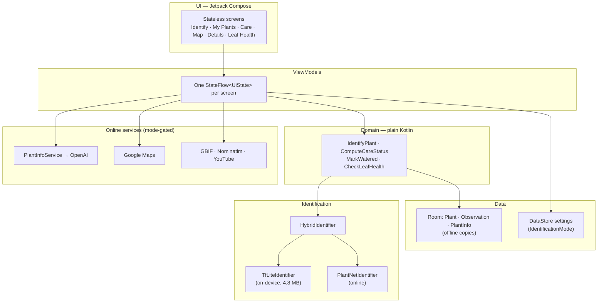

<div align="center">

<!-- TODO(M10): docs/banner.png — 1280x400 collage of 3 phone frames on the cream (#F7FAF2) background

-->

# 🌿 Wildflower

**Identify plants with your camera — on your terms.**
One app, two modes: *online* for the most accurate identification (Pl@ntNet + AI insights),
or *fully on-device* where no photo ever leaves your phone.

[](https://github.com/Wanru-P/Wildflower/actions)

[Features](#-features) · [Architecture](#-architecture) · [Tech stack](#-tech-stack) · [Build & run](#-build--run) · [Privacy](PRIVACY.md)

</div>

---

## 📸 Screenshots

| Identify | Result | My Plants | Care |
|---|---|---|---|
|  |  |  |  |

| Species explorer | Offline copy | Leaf health + AI | Offline garden map |
|---|---|---|---|
|  |  |  |  |

## ✨ Features

- **Two identification modes, one honest choice** — pick at onboarding, switch anytime.
  *Online (recommended):* Pl@ntNet identification with broad species coverage, falling back
  to on-device automatically when you're offline. *On-device:* a bundled 4.8 MB TensorFlow
  Lite classifier; photos never leave the phone. Every network feature in the app is gated
  on this one setting.
- **A viewfinder that coaches you** — the framing guide turns green when a plant is
  centered, close, sharp, and lit, with directional hints ("aim left", "move closer",
  "hold steady") driven by a model-free YUV heuristic that costs zero API calls. Plus
  torch toggle, tap-to-focus, pinch-to-zoom, and freeze-on-capture with a scanning
  "decoding plant…" animation while the classifier works.
- **Confidence-aware results** — high confidence shows one answer with alternates;
  low confidence says *"Not sure — here are some possibilities"* instead of pretending.
- **Species deep-dives that work offline** — "Learn more" fetches AI-generated care
  notes, regional names (Hindi, Marathi, Tamil…), propagation, a real-world map of
  native regions, GBIF occurrence data, and care videos. Everything except videos is
  **auto-saved on view**, so details you've read online stay readable in on-device mode —
  with per-plant "Info saved" chips showing what's available.
- **My Plants collection** — nickname your plants (Marlowe, Percy, Finn…), track them
  in a photo grid with live care-status chips computed — never stored — from
  `lastWateredAt + interval`.
- **Care schedules & reminders** — Overdue / Today / This week dashboard, WorkManager
  notifications that deep-link into the app, and a mark-watered flow with both a
  confirmation dialog and an undo window (nothing is written until Undo expires).
- **Leaf health check** — an on-device color heuristic gives a plain, hedged verdict
  ("a little yellow — not a diagnosis, just a friendly nudge"); online mode adds an
  AI second opinion below it, clearly labeled.
- **Observation map, twice** — online: a live Google Map with pulsing pins and
  auto-fit camera. On-device: a hand-illustrated "garden path" rendered entirely in
  Canvas from your real GPS pins — no tile server exists to phone home to.
- **A living UI** — parallax foliage drifts behind the main screens (seamlessly
  looping, alpha-tuned to never fight the content).
- **Privacy by disclosure, not slogan** — [PRIVACY.md](PRIVACY.md) names every service,
  what it receives, and when. No analytics, no accounts, no backend. In on-device mode,
  no network calls at all.

## 🏛 Architecture

FloraLens is a single-module MVVM app (multi-module would obscure the structure at this
size, not showcase it):



**Rules the code holds itself to:**

1. UI never touches Room, TFLite, or a network client directly — only ViewModels.
2. ViewModels expose a single `StateFlow<UiState>` per screen; screens are stateless
   and preview-able.
3. `Observation` is the one event table: identified / watered / note / leaf-check rows
   all live there. History, map pins, and the health log are just three queries over it.
4. Care status is **always derived** from `lastWateredAt + intervalDays`, never persisted —
   one source of truth, trivially unit-testable.
5. Anything replaceable hides behind an interface with a Hilt `@Binds`:
   - `PlantIdentifier` → `TfLiteIdentifier` / `PlantNetIdentifier` (routed by `HybridIdentifier`)
   - `PlantInfoService` → **swapped from Gemini to OpenAI by changing one `@Binds` line.**
     The unbound `GeminiPlantInfoService` stays in the tree as living proof of the pattern.

## 🎨 Design system

The UI implements a complete Material 3 token spec: a green-forward palette
(forest `#1B4332` primary, amber `#E8A33D` for water alerts, cream `#F7FAF2` surfaces),
the full M3 type scale with Lora serif headlines, a 4dp spacing grid, and the M3 shape
scale. Reusable components (`ConfidenceMeter`, `PrivacyBadge`, `StatusChip`,
`LivingBackground`, …) ship with `@Preview`s — open `ui/components/` in the IDE preview
pane to browse the kit.

## 🔧 Tech stack

| Layer | Choice | Why |
|---|---|---|
| UI | Jetpack Compose + Material 3 | Token spec maps 1:1 to M3 color roles / type / shape |
| DI | Hilt | Standard, low ceremony — and the `@Binds` swap point for providers |
| Persistence | Room + DataStore | Offline-first; Flow-based queries drive the UI reactively |
| Camera | CameraX | Lifecycle-aware viewfinder, tap-to-focus, torch, zoom |
| ML (on-device) | TensorFlow Lite | The 4.8 MB bundled classifier behind on-device mode |
| Identification (online) | Pl@ntNet API | Accuracy and coverage the compact model can't match |
| AI insights | OpenAI (via `PlantInfoService`) | Structured JSON species details + leaf-photo vision notes |
| Map (online) | Google Maps (maps-compose) | Real tiles, my-location, pulsing observation pins |
| Map (on-device) | Pure Canvas illustration | No map library at all — nothing to phone home |
| Networking | OkHttp (no Retrofit) | Four small clients don't justify a codegen layer |
| Reminders | WorkManager | Deferrable, battery-friendly notifications |
| Testing | JUnit + Turbine + Compose UI tests | Care-schedule logic is the unit-test showcase |
| CI | GitHub Actions | Build + test on every push |

## 🚀 Build & run

```bash
git clone https://github.com/Wanru-P/Wildflower.git
cd Wildflower
./gradlew installDebug   # or open in Android Studio
```

**It builds and runs with zero API keys** — you'll get the full on-device experience
(identification, care, leaf checks, the canvas map). Online mode needs keys in
`local.properties` (gitignored; see [PRIVACY.md](PRIVACY.md) for what each service receives):

```properties
PLANTNET_API_KEY=...   # my.plantnet.org — identification
OPENAI_API_KEY=...     # platform.openai.com — species details + leaf AI insights
MAPS_API_KEY=...       # Google Cloud, Maps SDK for Android — online map
YOUTUBE_API_KEY=...    # Google Cloud, YouTube Data API — care videos
```

> **Note:** on-device identification uses a compact bundled classifier (4.8 MB) chosen
> for size, not accuracy — that trade-off is exactly why online mode exists and is the
> recommended default. The `PlantIdentifier` interface makes swapping in a stronger
> model a one-file change.

## 🧪 Tests

```bash
./gradlew test
```

Highlights: `CareStatusTest` (overdue/today/this-week edge cases — month boundaries,
never-watered plants, interval changes), `IdentifyPlantTest` (confidence-threshold
routing), `MyPlantsViewModelTest` (reactive grid + the offline info-availability chip),
DAO tests with in-memory Room.

## 🗺 Roadmap

- [ ] Leaf-health model v2
- [ ] Plant care notes & photo journal
- [ ] Home-screen widget for today's watering
- [ ] Export/import collection (local file — still no cloud of ours)

## 📄 License

MIT
